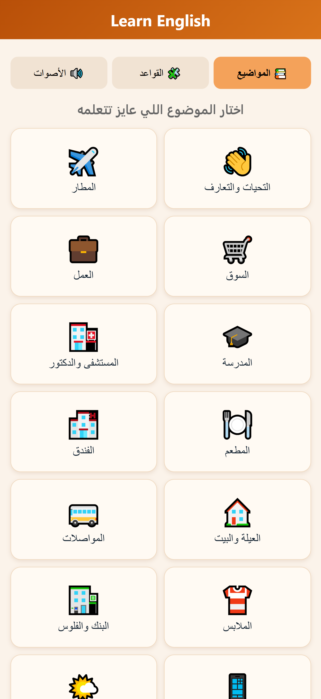
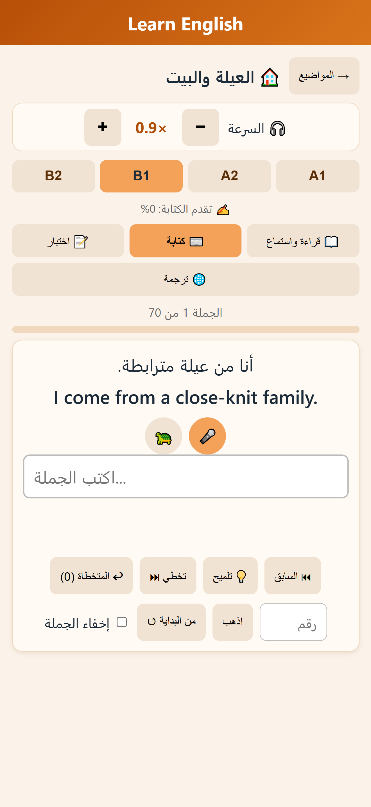
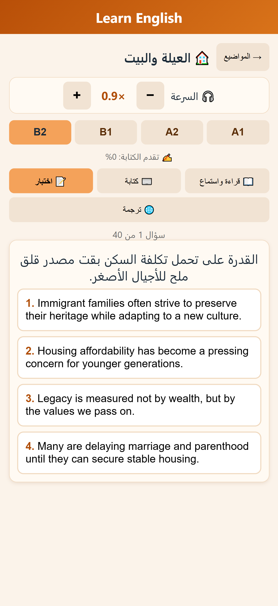

# 🌍 Learn English — Interactive Web App

[](https://github.com/HozaifaMosaad-Attia/learn-english/actions/workflows/validate.yml)

An interactive, responsive English learning platform for **Arabic speakers**. Learners study real-life sentences, practice typing and listening, take quizzes, and work through grammar and pronunciation lessons across four CEFR levels (A1–B2). Built with **HTML5, CSS3, and vanilla JavaScript** — no frameworks and no build step. The interface and explanations are in Arabic.

🔗 **Live demo:** https://HozaifaMosaad-Attia.github.io/learn-english/

<p align="center">
  <a href="docs/home.png"></a>
  <a href="docs/typing.png"></a>
  <a href="docs/quiz.png"></a>
</p>

<p align="center"><sub>Topics · Typing practice · Quiz (click an image to enlarge)</sub></p>

---

## ✨ Features

| Area | What it does |
| --- | --- |
| 📖 **Read & listen** | Every sentence has an Arabic translation, normal and slow playback, and an adjustable speed (0.5×–1.15×), using American English voices via the Web Speech API. |
| ⌨️ **Typing practice** | Type each sentence from its Arabic meaning. Smart answer checking accepts contractions (`I am` ↔ `I'm`), requires correct inner punctuation, and treats final punctuation as optional. Includes hints, skipping, and a dictation mode that hides the sentence and plays it aloud. |
| 📝 **Quiz** | 40 randomized questions per topic and level, with a review of the sentences you missed. |
| 🌐 **Translate** | Arabic ↔ English translation with a spelling check. It uses the built-in sentence bank first, then falls back to an online service. |
| 🧩 **Grammar hub** | 42 lessons across A1–B2: explanations in Arabic, tables, examples with audio, and practice questions. |
| 🔊 **Phonetics hub** | 34 pronunciation lessons: IPA symbols, minimal pairs, word stress, connected speech, and sounds that are hard for Arabic speakers (p/b, v/f, th, American R, consonant clusters). |
| 💾 **Progress** | Typing progress, best quiz scores, and lesson scores are saved in the browser with `localStorage`. |

### 📚 Curriculum

- **4 levels:** A1, A2, B1, B2
- **15 situational topics:** Greetings & Introductions, Airport, Market, Work, School, Hospital, Restaurant, Hotel, Family & Home, Transport, Clothes, Bank, Phone & Technology, Weather & Seasons, Hobbies
- **4,200+ sentences** with Arabic translations
- **700+ practice questions** in the grammar and phonetics lessons

---

## 🛠️ Engineering notes

- **Vanilla JS (ES6+)**, CSS Grid and Flexbox, right-to-left (Arabic) responsive layout.
- **Lazy loading:** content files are fetched only when a topic, level, or lesson is opened, and versioned with a cache-busting query string.
- **Answer matching:** for each target sentence the app generates every valid variant (contracted and expanded forms) and compares the typed text against them live, so wrong characters are flagged as you type.
- **Content validation:** [`tools/validate.js`](tools/validate.js) checks every data file (structure, duplicates, missing translations, and the answer index of every quiz question). It runs automatically on each push through GitHub Actions.
- **Security:** a strict Content-Security-Policy, and lesson content is rendered as text rather than injected as HTML.
- **Accessibility basics:** labelled icon buttons, `lang` attributes on English text, visible keyboard focus, keyboard shortcuts (Enter for a hint, 1–4 in quizzes), and reduced-motion support.
- **Graceful fallback** when the browser has no speech synthesis.

### Third-party services

- [Datamuse API](https://www.datamuse.com/api/) — spelling check in the translate tab.
- [MyMemory API](https://mymemory.translated.net/doc/spec.php) — translation fallback.

Both are used only in the Translate tab.

---

## 📁 Project structure

```text
learn-english/
├── index.html
├── style.css
├── script.js
├── data/
│   ├── topics.js          # list of topics
│   ├── a1/ a2/ b1/ b2/   # sentences: one file per topic
│   ├── grammar/           # a1.js … b2.js
│   └── sounds/            # a1.js … b2.js
├── tools/
│   └── validate.js        # content validator
└── .github/workflows/
    └── validate.yml       # runs the validator on every push
```

---

## 💻 Getting started locally

No installation or build step is required.

```bash
git clone https://github.com/HozaifaMosaad-Attia/learn-english.git
cd learn-english
```

Open `index.html` in your browser, or serve the folder with any static server (for example the VS Code **Live Server** extension).

To validate the content before committing:

```bash
node tools/validate.js
```

---

## 🚀 Roadmap

- [x] Situational topics across A1–B2
- [x] Grammar hub with practice questions
- [x] Phonetics and pronunciation lessons
- [x] Speech synthesis with slow mode and speed control
- [x] Progress saving with `localStorage`
- [x] Automated content validation
- [ ] Spaced repetition for sentences you got wrong
- [ ] Export and import progress
- [ ] Installable PWA with offline support
- [ ] Dark mode
- [ ] Unit tests for the answer matcher
- [ ] Split `script.js` into ES modules
- [ ] Speech recognition for speaking practice

---

## 👨‍💻 Author

**Hozaifa Mosaad** — Front-end developer

GitHub: [@HozaifaMosaad-Attia](https://github.com/HozaifaMosaad-Attia)
